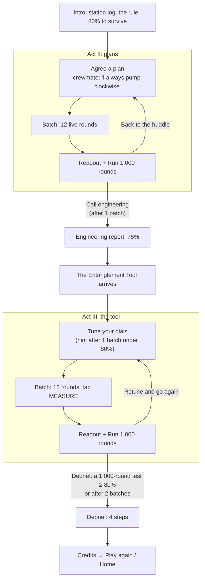

# Quantum Crew

> A co-op party game where two tables of crew keep a space station alive, hit a wall no plan can beat, and then
> break through it with entanglement.

An example game from [Playable Stories](https://github.com/PlayableStories), built with an AI coding agent
(Claude Code). Originally made for Moth Hack 2026 (11 FQxI Challenge).


**Play the solo demo:** https://quantum-crew-iota.vercel.app/solo

Quantum Crew is inspired by *Spaceteam*. Players never sit through a physics lecture. They feel a limit first, and
only then learn what it is.

**Learning arc:** collaborate → keep the station stable → hit a wall at 75% → experiment → get a quantum tool →
beat the wall.

## Story and player flow
*Station log · shift 1.* The station's coolant runs round a **ring** that passes through two sections. In solo mode
you are at **Table A** and an AI crewmate is at **Table B**, and each table runs the **pump** in its own section,
**CLOCKWISE** or **ANTICLOCKWISE**. The reactor flares at random, so each round each section's sensor reads **COOL**
(blue, snowflake) or **HOT** (orange, flame). You see only your own sensor, you can't talk during a round, and you
have 5 seconds. A **relief vent** between the sections unlocks automatically only when **both** sections are HOT, and
nobody can see whether it's unlocked.

The rule follows from the plumbing, and it's always on screen next to a diagram of the ring:
*keep the coolant flowing one way round the ring; if BOTH sections run HOT, pump against each other to purge*
(quick rule: pumps MATCH, unless both sensors are HOT, then they must DIFFER). The station needs **80%**:
the core can take one bad round in five, and no more.

| Sensors | Pumps agree | Pumps fight |
|---|---|---|
| Both COOL | ✓ **Circulating**: coolant flows round the ring | ✗ **Pressure spike**: the vent is locked |
| One HOT | ✓ **Heat carried off** to the cool side | ✗ **Pressure spike**: the vent is still locked |
| Both HOT | ✗ **Overheat**: hot coolant goes round in circles | ✓ **Purge**: the vent is unlocked and the hot coolant goes out |



1. **Agree a plan (Act II).** In the strategy huddle your crewmate radios in: *"I always pump clockwise. Standard
   procedure."* You choose a pump direction for COOL and one for HOT. Against a crewmate who always pumps clockwise,
   the best any plan can do is 75%, so the best plan loses one round in four:

   | Your plan (COOL / HOT) | Win rate |
   |---|---|
   | CLOCKWISE / CLOCKWISE | 75% |
   | CLOCKWISE / ANTICLOCKWISE | 75% |
   | ANTICLOCKWISE / ANTICLOCKWISE | 25% |
   | ANTICLOCKWISE / CLOCKWISE | 25% |

2. **Play a batch.** Twelve live rounds. Your plan's direction is tagged "Plan", but you set the pump yourself and
   can go against it. Each result names what happened (Circulating, Heat carried off, Purge, Pressure spike, Overheat
   or Too slow) and shows both sensors and both pumps. A pressure spike with only one side HOT says why: the vent
   stays locked unless BOTH are HOT. Running out of time counts as a loss.
3. **Run 1,000 rounds.** After each batch, the readout shows how many rounds held, and the station art degrades as
   stability drops. Twelve rounds are noisy, so **Run 1,000 rounds** tests your *plan* (not your taps) against
   1,000 fresh pairs of sensor readings. Whatever you try, it never beats 75%.
4. **Call engineering.** After the first batch you can call engineering (or go back and try more plans).
   *"We tried every plan your crew could make. Every single one. None of them holds more than 75%: the best plan
   loses one in four."* The core can take one in five. *"Then we need something that isn't a plan."*
5. **Receive the tool.** The game changes look (a live Entanglement Shader, two synced crystals). *Two linked
   crystals have arrived: one in your tool, one in your crewmate's at Table B.* You turn a dial and tap
   **MEASURE**, and the crystal decides your pump direction.
6. **Tune your dials (Act III).** One dial for COOL and one for HOT, 8 stops each (0° to 157.5° in 22.5° steps),
   starting at 0°/0°. Your crewmate's tool is already tuned (hidden: 22.5° for COOL, 157.5° for HOT). In each round
   your dial turns to the angle for your sensor and you tap MEASURE. You choose *how* the crystal is read, not the
   pump direction. After a batch under 80%, you can ask engineering for a hint: *"Try making your two dials 45° apart, and
   your partner's offset by half that."*

   | Your dials (COOL / HOT) | Win rate |
   |---|---|
   | **0° / 45°** | **85.4%**, the only best setting of the 64 |
   | 0°/22.5°, 0°/67.5°, 22.5°/45°, 157.5°/45° | 80.2%, which passes a 1,000-round test about half the time |
   | 0° / 0° (the start) | 67.7% |

7. **Result.** The debrief unlocks when a 1,000-round test reaches **80%** or more, or after **2** Act III batches,
   so every player reaches the end.
8. **Debrief.** The physics words appear only here, in four steps:
   - **No plan beats 75%:** the fiction mapped back to the game (sensors = input bits, pumps = output bits, "match
     unless both HOT" = the CHSH rule), and the wall was a Bell inequality, with your Act II rate.
   - **Entanglement broke through:** the crystals agree with probability cos²(θA − θB), up to 85.4% (the Tsirelson
     bound), with your best test and the optimal dials for both tables.
   - **But no messages:** over 10,000 rounds your pump runs clockwise about half the time whatever your crewmate's
     sensor read, so no message gets through (no-signalling).
   - **Credits**, then *Play again* or *Home*.

All player-facing text is in `src/strings.ts`; pacing and unlock rules are in `src/config.ts`.

## How to play (solo)
Open the app and choose **Solo demo**. It takes about 6 minutes on a phone or a laptop.

1. **Briefing.** You are Table A. An AI crewmate is Table B. Each round your sensor reads **COOL** or **HOT**, and
   you set your pump **CLOCKWISE** or **ANTICLOCKWISE** within 5 seconds. The station rule is always on screen:
   *pumps MATCH, unless both sensors are HOT, then they must DIFFER* (the vent only unlocks on a double HOT).
   The station needs **80%**.
2. **Act II: plans.** Your crewmate tells you their plan ("I always pump clockwise"). Pick yours, then play batches of 12
   rounds. After each batch, **Run 1,000 rounds** tests your plan without small-sample luck. Whatever you try,
   it never beats 75%.
3. **Engineering report.** After the first batch you can call engineering (or try more plans first): no plan beats 75%.
4. **Act III: the Entanglement Tool.** You get two dials, one for COOL and one for HOT. In each round, tap
   **MEASURE** and the tool sets your pump. Experiment until the 1,000-round test passes 80%. After a batch under
   80%, a hint appears; after two batches the debrief opens either way.
5. **Debrief.** You learn the physics and see your own numbers, then the credits.

Keyboard: **A / ←** = ANTICLOCKWISE, **C / →** = CLOCKWISE, **Space / Enter** = MEASURE.

## How to play (event)
Two tables of players, one phone each, and a TV or projector. A facilitator runs the session from the TV.

1. Open **/screen** on the TV (landing page → **Host on TV**). It creates a station with a 4-letter code and a QR code.
2. Players scan the QR (or open **/play** and type the code), enter a name and pick **Table A** or **Table B**.
   The server pairs A₁↔B₁, A₂↔B₂… (up to 4 pairs). An AI crewmate fills any empty seat.
3. **Start strategy huddle (45 s):** partners may talk across tables and agree a plan. When the clock runs out, the
   comms blackout starts and so does the batch (or press **Start batch now**).
4. Each round, every phone shows only its own sensor, two pump buttons and a countdown. The TV shows the round
   timer, who has answered and each pair's result (Stable or Leak). Stability is pooled over the last 48 rounds across all pairs, and
   each pair also has its own mini-meter.
5. Play a few batches, then **Reveal ceiling**: the TV shows the engineering report (no plan beats 75%).
6. **Unlock tool**: every pair gets the Entanglement Tool. Phones show two dials (one for COOL, one for HOT); use a
   huddle to agree settings. In each round a phone shows its sensor, the dial angle in use and a **MEASURE** button.
   The server decides who measured first: that result is a fair coin, and the partner's result is conditioned on it.
   The TV adds the 85.4% line. **Show hint** puts the engineering hint on the TV.
7. **Debrief** on the TV (Back / Next): the Bell/CHSH wall with the crew's Act II score, the Tsirelson bound with
   the best dial settings and the crew's Act III score, then **no-signalling**: every crew member's clockwise rate
   split by what their partner's sensor read (≈ 50/50 both ways, pooled for the whole crew), then credits.

A phone that reloads or drops out rejoins its seat automatically (same name, same table).

## The physics
This is the **CHSH game**, a Bell test. Two players who can't talk each get a random bit (the sensor: COOL = 0,
HOT = 1) and output a bit (the pump: CLOCKWISE = 0, ANTICLOCKWISE = 1). They win if `a XOR b == x AND y`, which is
"pumps match unless both are HOT". The ring, the pumps and the vent are the story around that rule.

- **Classical limit: 75%.** Every plan agreed in advance, random or not, is at best a mix of the 16 deterministic plan
  pairs, and none of those wins more than 3 of the 4 sensor combinations.
- **Quantum limit: cos²(π/8) ≈ 85.4%.** The players share an entangled pair of qubits (the Bell state |Φ+⟩). Each measures at
  an angle chosen by their own sensor, and the results agree with probability cos²(θA − θB). The best angles are
  A: 0°/45° and B: 22.5°/−22.5°. No quantum strategy beats this (the Tsirelson bound).
- **No signalling.** Each player's own pump direction is a 50/50 coin whatever the partner's sensor or dial. Only the
  *correlation* between the two players changes, so the tool can't carry a message. The debrief shows this with the
  player's own tool settings.

Further reading: [IBM Quantum Learning: the CHSH game](https://quantum.cloud.ibm.com/learning/en/courses/basics-of-quantum-information/entanglement-in-action/chsh-game).

In the game, the entangled pair is simulated with the exact quantum probabilities (`src/shared/chsh.ts`). The first
player to measure gets a fair coin, and the second player's result matches it with probability cos²(Δθ).

## Atlas engines
The station art, its degradation levels, the crew avatars, the tool reveal and the sounds are made with Moth Quantum
Atlas engines on platform.mothquantum.com. They are listed with their parameters in `src/assets/atlas/list.ts` and
on the Credits screen. Any asset that hasn't been added yet shows a placeholder (CSS/SVG art, or a short Web Audio
sound), so the game always works.

| Asset | Engine |
|---|---|
| `station-base`, `crew-icons` | Tessa (`tessa-image-v1`) |
| `station-stability-0…4` | Quantum Blur (`blur-v1`) |
| `entanglement-reveal` | Entanglement Shader (`entanglement-shader-v1`), **rendered live** (see below) |
| `sfx-alarm`, `sfx-win`, `sfx-reveal` | Atlas sound engine (to confirm) |

### The Entanglement Shader, live
`entanglement-shader-v1` doesn't return an image: it simulates light bouncing between stacked, ultra-thin conducting
layers with entangled (quantum) interactions, and returns a shader plus two lookup tables (how much red, green and
blue light is reflected or transmitted at each viewing angle). The engine's raw output is committed in
`atlas-src/entanglement-shader/`. `pnpm bake-shader` decodes its lookup tables into
`src/assets/atlas/entanglement-lut.json`, and `src/atlas/entanglementShader.ts` runs a WebGL 2 port of the engine's own
GLSL in the browser. The tool's two crystals tilt in sync and shift colour with the viewing angle, and the same
shader ripples behind the tool reveal and every Act III screen. Without WebGL 2 the CSS placeholders show instead.

### Generating the station art (`pnpm gen-assets`)
`pnpm gen-assets` draws a 64×36 pixel-art station and a 64×32 crew sprite in code
(`scripts/lib/inputs.ts`), uploads them and runs the engines through `@moth-hack/atlas-client` (1 credit per job):
Tessa on a noisy `fake_fez` simulator for `station-base` / `crew-icons`, then Quantum Blur at strengths
0.05 / 0.25 / 0.45 / 0.7 / 1.0 for `station-stability-4 … 0`. Each result is saved with a `.provenance.json` (engine,
job id, params), which the Credits screen shows. Existing assets are skipped unless `--force`; `--dry-run` shows the
plan. On 6 Oct the Tessa engine timed out (`engine_timeout`, three tries, also on `aer`), so the five Blur levels were
made from the drawn station with `--blur-source drawn`; `station-base` and `crew-icons` keep their placeholders.

### Adding an asset
1. Make it on the platform and save it into `src/assets/atlas/`, named after its key with any extension
   (`station-stability-2.png`, `entanglement-reveal.webm`, `sfx-win.mp3`…). Vite picks it up; no code change.
2. Fill its `params` in `src/assets/atlas/list.ts` so the Credits screen shows how it was made.
3. Run `pnpm assets` for a checklist: present / missing, missing params, files over
   5 MB, and types the repo gitignores (`.mp4`, `.wav`: use `.webm`, `.png`, `.mp3`).

Where they appear: `station-base` and `station-stability-0…4` on the TV, readouts and landing (the level follows
stability: 0 failing … 4 stable); `crew-icons` (one image, Table A left half, Table B right half) on the TV pair
cards and phones; `entanglement-reveal` behind the tool reveal and as the Act III background; `sfx-win` on a won
round, `sfx-alarm` when stability drops below 80% or a batch ends below it, `sfx-reveal` when the tool arrives.

### Sound
Every screen has a mute button. Sound is on by default in solo and on the TV, and off by default on event phones
(a room of 8 phones chiming is a lot); each device remembers its choice.

## Run it locally
Needs Node ≥ 22.18 (`nvm use` picks up `.nvmrc`) and pnpm (`corepack enable`).

```sh
pnpm install
pnpm dev        # http://localhost:5173/solo
pnpm dev:phone  # same, reachable from a phone on your Wi-Fi
pnpm test       # core logic + solo flow tests
pnpm sim        # classical best, quantum optimum, top-5 dial setups
pnpm assets     # Atlas asset checklist
pnpm build      # static build in dist/
```

`pnpm dev` also runs the station (WebSocket at `/ws`) inside the Vite dev server, so event mode works locally.
To test with real phones, open the TV page via the **Network** URL that Vite prints (e.g. `http://192.168.x.x:5173/screen`)
so the QR code points somewhere phones can reach. To test alone, use one `/screen` tab and a few `/play` tabs.

```sh
pnpm smoke   # real WebSocket server + 1 TV + 4 phones, one Act II batch
```

## Deploy
- **Solo only (static):** the solo mode needs no server or API key. Deploy `dist/` anywhere; `vercel.json`
  rewrites every route to `index.html`. On a static host, the event-mode buttons stay disabled.
- **Event mode (one Node process):** `server/index.ts` serves `dist/` and the WebSocket on the same origin.
  Use any host that supports WebSockets (Render, Railway, Fly…):
  - build: `pnpm install && pnpm build`
  - start: `pnpm start` (listens on `$PORT`, default 8787; Node ≥ 22.18 runs
    the TypeScript directly)

  Rooms live in memory, so a restart ends every session. Health check: `/healthz`.

## Built with an AI coding agent
Quantum Crew was designed by a person and written almost entirely by Claude Code, in milestones (M0–M5), one branch
and one reviewed pull request per milestone. [`CLAUDE.md`](CLAUDE.md) is the agent's working memory: goal, layout,
decisions, rules for the Atlas API, and status. It is kept up to date as the game changes, so a fresh agent session
can pick the project up where the last one left off.

## Origin
Made for [Moth Hack 2026](https://hack.mothquantum.com) (11 FQxI Challenge) in the
[moth-hack-2026](https://github.com/WWStoryMode/moth-hack-2026/tree/main/apps/quantum-crew) monorepo and moved here as
a standalone repo. The hackathon submission record is in [`docs/moth-hack-2026/`](docs/moth-hack-2026/).

## License
Code: [MIT](LICENSE). The Atlas engine outputs in `src/assets/atlas/` and `atlas-src/` were generated on the
[Moth Quantum](https://platform.mothquantum.com) platform and follow its terms.
