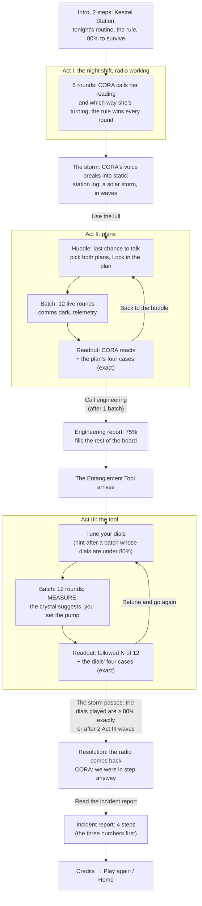

# Quantum Crew

> A co-op party game where two tables of crew keep a space station alive, hit a wall no plan can beat, and then
> break through it with entanglement.

An example game from [Playable Stories](https://github.com/PlayableStories), built with an AI coding agent
(Claude Code). Originally made for Moth Hack 2026 (11 FQxI Challenge).


**Play the solo demo:** https://quantum-crew-iota.vercel.app/solo

Quantum Crew is inspired by *Spaceteam*. Players never sit through a physics lecture. They feel a limit first, and
only then learn what it is.

**Learning arc:** collaborate → keep the station stable → hit a wall at 75% → experiment → get a quantum tool →
beat the wall.

## Story and player flow
*Station log · Kestrel Station.* **Kestrel Station** drifts on the edge of a young, restless star: a research platform
powered by a reactor core, cooled by a coolant **ring** that runs through its two sections. You keep the night shift
at **Table A**. **Table B** is run by **CORA**, the station's Coolant Ring Assistant: an AI, not a person (her name
always carries a small **AI** badge), who has kept the ring running for years and trusts procedure above everything.
Engineering works from the supply deck at the far end of the station. Each table runs the **pump** in its own section,
**CLOCKWISE** or **ANTICLOCKWISE**. When the star flares, one section or the other heats up without warning, so each
round each section's sensor reads **COOL** (blue, snowflake) or **HOT** (orange, flame). A **relief vent** between
the sections unlocks automatically only when **both** sections are HOT, and nobody can see whether it's unlocked.

The game's three numbers tell the story:
- **Act I, comms open (100%):** on a quiet night you call your readings over the radio, so every round can hold.
- **Act II, comms lost (75%):** a solar storm knocks the radio out in waves, and no plan agreed in advance beats 75%.
- **Act III, the crystals (≈ 85%):** two linked crystals beat every plan without carrying a single message.

Act I was milestone M6 in the hackathon plan, never built then; it's built now (solo). In solo the storm frames
everything after it: each **batch is a storm wave** (counted across Acts II and III), the huddle is **the lull**
between waves, the tool arrives in a **supply pod** from engineering, and after the last wave **the storm passes**:
the radio comes back and the debrief becomes **Kestrel Station's incident report**.

The rule follows from the plumbing, and it's always on screen next to a diagram of the ring:
*keep the coolant flowing one way round the ring; if BOTH sections run HOT, pump against each other to purge*
(quick rule: pumps MATCH, unless both sensors are HOT, then they must DIFFER). The station needs **80%**:
the core can take one bad round in five, and no more.

| Sensors | Pumps agree | Pumps fight |
|---|---|---|
| Both COOL | ✓ **Circulating**: coolant flows round the ring | ✗ **Pressure spike**: the vent is locked |
| One HOT | ✓ **Heat carried off** to the cool side | ✗ **Pressure spike**: the vent is still locked |
| Both HOT | ✗ **Overheat**: hot coolant goes round in circles | ✓ **Purge**: the vent is unlocked and the hot coolant goes out |

**The storm on the art.** From the storm screen until the resolution, the station art shows the solar storm: the star
flaring across one edge and static over the picture, one degradation level lower. At the resolution it clears, to a
calm station if you saved it or a damaged one if you didn't. The intro and Act I stay calm. With reduced motion the
storm is a still glow and texture.

**Comms.** In Act I the radio works; from the storm on, talking is only possible between waves. Solo mode shows that
with three states:
- **Comms open** (Act I's night shift, the huddle, the readout, the engineering report, the tool reveal, tuning):
  CORA talks on the radio. In Act I she calls her reading every round; the huddle is the last chance to talk before
  a batch.
- **Comms dark** (during a storm wave): the radio is down, shown as static, and CORA says nothing.
- **Station telemetry** (after each round): one impersonal sentence on why the round held or failed, e.g. *"The
  pumps fought, but the vent stays locked unless both sections are HOT."* The ring shows both sensors and pumps.



0. **The night shift (Act I).** Six rounds with the radio working. CORA opens with *"Quiet night. Each round I'll
   call my reading and which way I'm turning. Call yours, and keep us in step."*, then each round calls her reading
   and her pump, which varies at random from round to round (*"Cool here. Turning anticlockwise."* / *"Hot here!
   Turning clockwise."*). You see your own sensor, so with both readings and her pump the rule tells you exactly what
   to do: match her pump, unless both are HOT, then turn the other way to purge. The six rounds include every combination of the two
   sensors, with at least one both-HOT round (never the first), so you see a purge. You have 8 seconds; a mistake or
   a timeout loses the round, explained like any other result. The stability gauge shows the station holding near
   100%. Then **the storm**: CORA starts a line and it breaks into static (*"Something's coming off the star. Hold
   the pumps st—"*), and the station log explains: a solar storm arriving in waves, which the radio won't survive; it
   may come back for a moment between them. **Use the lull** takes you to the first huddle.
1. **Agree a plan (Act II): the last chance to talk.** Two dialogue boxes, **You** and **CORA [AI]**, each offer
   the four plans (always clockwise, reverse when HOT, reverse when COOL, always anticlockwise) with their COOL/HOT
   moves as icons. You pick for both; CORA starts on always clockwise ("standard procedure") and confirms what you
   pick for her on the radio. **Lock in the plan** starts the batch: comms go dark until it ends. Every pair you play
   goes on the **plan board**, your four plans against hers. Its shape is the wall: 8 pairs reach 75%, 8 reach 25%,
   and none beats 75%.

   | You ↓ · Crewmate → | Always clockwise | Reverse when HOT | Reverse when COOL | Always anticlockwise |
   |---|---|---|---|---|
   | **Always clockwise** | 75% | 75% | 25% | 25% |
   | **Reverse when HOT** | 75% | 25% | 75% | 25% |
   | **Reverse when COOL** | 25% | 75% | 25% | 75% |
   | **Always anticlockwise** | 25% | 25% | 75% | 75% |

2. **Play a batch.** Twelve live rounds with **comms dark**. A reminder shows the agreed plan, e.g. *"Agreed: you
   COOL → clockwise, HOT → anticlockwise · CORA always clockwise"*. CORA plays the plan you set for her. Your plan's
   direction is tagged "Plan", but you set the pump yourself and can go against it (5 seconds; running out of time
   is a loss). Each result shows the cause (Circulating, Heat carried off, Purge, Pressure spike, Overheat or Too
   slow), one sentence of station telemetry on why, and the **coolant ring**, with both sensors and both pumps
   labelled. The result stays until you tap **Next round** (or press Space / Enter); after 6 seconds it moves on by
   itself. The ring plays the round back:
   - each half lights up COOL or HOT;
   - each pump spins the way it ran;
   - the vent opens on a double HOT;
   - you see the coolant circulate, carry the heat off, purge out of the vent, spike where the two flows collide,
     overheat, or stall at a pump that never moved.

   On a landscape screen the ring sits beside your sensor and stays blank during the round itself, so it never gives
   away your crewmate's sensor. On a phone a smaller ring appears with the result. With reduced motion it's a still
   picture with the same marks. Every stability gauge runs from 0% to 100%.
3. **Readout.** Comms are back on: CORA reacts to the batch with the facts of one round (e.g. *"Round 7: you were
   hot, I was cool, and our pumps fought."*). She never says who reversed or whose fault it was: with different plans
   the pumps can fight without anyone going against the plan. Twelve rounds are noisy, so **If we both follow the
   plan perfectly** shows the plan's four sensor combinations (COOL/COOL, COOL/HOT, HOT/COOL, HOT/HOT, each equally
   likely): each side's pump, the outcome and ✓ or ✗, then the true rate, e.g. *"3 of 4 cases: 75%"*. It's exact,
   with no sampling. If the batch passed 80% on a plan that can't: *"Above 80% this time, but this plan's true rate
   is 75%. Twelve rounds is mostly luck."* Back in the huddle with the same plan, CORA suggests a pair you haven't
   tried.
4. **Call engineering.** After the first batch you can call engineering (or go back and try more plans). Engineering
   works out every pair you didn't try (a corner mark on those squares): *"You tried 2. We ran the other 14."* The
   board shows every square's **exact** rate, 75% or 25%: *"The best plan's true rate is exactly 75%: it loses one
   round in four. The station needs 80%. A batch above 75% is luck."* The crewmate: *"So it was never us."* Then: *"Then we need something that isn't a plan."*
5. **Receive the tool.** During a lull a **supply pod** docks from engineering. The game changes look (a live
   Entanglement Shader, two synced crystals). Engineering's note: the crystals don't carry messages, so the storm
   can't jam them; measure one and it gives a direction, linked to its partner in a way no plan can copy. CORA:
   *"A crystal that tells me which way to turn. Fine. That's my new procedure."*
6. **Tune your dials (Act III).** One dial for COOL and one for HOT, 8 stops each (0° to 157.5° in 22.5° steps),
   starting at 0°/0°. Your own dials come first and large. CORA's are one line, *"CORA: COOL 22.5° · HOT
   157.5°, locked"* (*"Mine sit where my crystal settles… Nobody knows yet if that's right."*), and **See dials**
   shows them in full; you tune only your own. On the first visit a short note explains the tool, without giving
   the answer: *"The closer your dial points to CORA's, the more often your crystals give the same direction. Need
   your pumps to match? Point close to hers. Need them to differ? Point far away."* There's no live rate while you
   turn the dials. After a batch whose dials didn't pass, **Ask engineering for a hint** opens: *"Try making your
   two dials 45° apart, and your partner's offset by half that."*

   **Rounds** last 7 seconds. Your dial turns to the angle for your sensor; you tap **MEASURE** and the crystal
   suggests a pump (*"Crystal says: ANTICLOCKWISE"*, that button highlighted). Then you set the pump yourself:
   Enter follows the crystal, A / C choose directly, and you may go against it. Scoring uses the pump you set; CORA
   always follows her crystal. The result shows the same way as in Act II.

   | Your dials (COOL / HOT) | Win rate |
   |---|---|
   | **0° / 45°** | **85.4%**, the only best setting of the 64 |
   | 0°/22.5°, 0°/67.5°, 22.5°/45°, 157.5°/45° | 80.2%, which passes the gate |
   | 0° / 0° (the start) | 67.7% |

7. **Readout and the gate.** The readout says *"You followed the crystal in N of 12 rounds."* CORA notices too:
   *"You went your own way a lot. I just did what my crystal said."* (more than 3 rounds against it) or *"You
   followed your crystal every round. So did I."* **If we both follow
   the crystals** shows the four sensor combinations with both dial angles and the exact chance each holds, then
   the dials' true rate. A luck line appears when the batch and the true rate disagree about passing 80%. The
   **debrief unlocks after a batch played with dials whose exact rate is 80% or more**, whatever the batch scored.
   Otherwise you ride out another wave (with the hint); after **2** Act III waves it opens either way, so every
   player reaches the end. **The storm passes** first, and how it ends depends on whether you **saved the station**
   (your dials passed the gate):
   - **Saved:** the station holds, calm and clear, and the radio comes back. CORA: *"I couldn't hear you the whole
     time. But we were in step anyway."*
   - **Not saved** (the report opened only because the last wave was played): engineering held the core together
     with emergency measures, and the station art shows the damage. CORA: *"We made it, just. Those crystals can do
     better than that. I'd like to know how."*

   **Read the incident report** opens the debrief.
8. **The incident report (debrief).** The physics words appear only here, in four steps. The first opens with the
   three numbers side by side: Act I with the radio (100% possible, and your own Act I score), Act II's best plan
   (75%) and Act III's crystals. If you saved the station, that's your dials' exact rate, with *"Talking made every
   round winnable. No plan could replace talking. The crystals beat every plan without carrying a single
   message."* If not, the report doesn't pretend: the card leads with the best dials (85.4%) and shows yours
   underneath (e.g. "your dials, 67.7%"), and the summary says the best crystal settings beat every plan, while
   yours didn't get there this time. Step 2's side-by-side views also show the best dials unless yours saved the
   station.
   - **No plan beats 75%:** the fiction mapped back to the game (sensors = input bits, pumps = output bits, "match
     unless both HOT" = the CHSH rule), and the wall was a Bell inequality, with your Act II rate. Mixing plans at
     random only averages cells on the plan board, so it can never beat the best cell.
   - **Entanglement broke through:** the crystals agree with probability cos²(θA − θB), up to 85.4% (the Tsirelson
     bound), with your dials' true rate. Two four-case views sit side by side: the best plan (three cases always
     held, one always lost: 75%) and your dials (or the best dials, if yours didn't pass), where every case holds
     about 85%. *A plan has to give up one case completely; the crystals spread a small loss across all four.*
   - **But no messages:** each pump runs clockwise exactly 50% of the time whatever the partner's sensor read
     (computed exactly), so no message gets through (no-signalling). Your own 12-round numbers sit underneath, and
     the report adds: *"That's why the storm couldn't jam them: there was no signal to jam."*
   - **Credits** (the Atlas asset list is behind **How the art was made**), then *Play again* or *Home*.

   Each step's explanation sits beside your own numbers on a landscape screen, and above them on a phone.

All player-facing text is in `src/strings.ts`; pacing and unlock rules are in `src/config.ts`.

## How to play (solo)
Open the app and choose **Solo demo**. It takes about 6 minutes on a phone or a laptop. On a laptop or a landscape
iPad the type, plan board, dials and ring scale up with the screen, and every screen still fits without scrolling.

1. **Briefing.** You keep the night shift at Table A on Kestrel Station. CORA, the station's AI, is Table B. Each round
   your sensor reads **COOL** or **HOT**, and you set your pump **CLOCKWISE** or **ANTICLOCKWISE**. The station rule:
   *pumps MATCH, unless both sensors are HOT, then they must DIFFER* (the vent only unlocks on a double HOT). After
   the briefing it stays on screen as a one-line chip; **Explain** opens the full rule card.
   The station needs **80%**.
2. **Act I: the night shift.** Six rounds with the radio working: CORA calls her reading and which way she's turning ("Hot here!
   Turning anticlockwise."; it varies at random), so the
   rule with both readings wins every round (8 seconds each). Then the storm knocks the radio out.
3. **Act II: plans.** In the huddle (the last chance to talk), pick your plan *and* CORA's, then **Lock in the
   plan**. Then play batches of 12 rounds (comms dark; the station's telemetry reports each round). Between
   batches CORA reacts on the radio, and the readout shows your plan's exact rate case by case. Whatever you try, no
   pair beats 75%.
4. **Engineering report.** After the first batch you can call engineering (or try more plans first): they fill in
   every pair you didn't try, and none beats 75%.
5. **Act III: the Entanglement Tool.** You get two dials, one for COOL and one for HOT; your crewmate's are locked
   where they set them (**See dials**). In each round, tap **MEASURE**: the crystal suggests a pump, and you set it
   (follow it or not). Find dials whose exact rate passes 80%; after a batch with dials that don't, you can ask
   engineering for a hint, and after two batches the debrief opens either way.
6. **The storm passes, then the incident report.** You learn the physics and see your own numbers, starting with
   the three that tell the story (100%, 75%, ≈ 85%), then the credits.

Keyboard: **A / ←** = ANTICLOCKWISE, **C / →** = CLOCKWISE. Act III: **Space / Enter** = MEASURE, then **Enter**
follows the crystal. On a round's result, **Space / Enter** = Next round.

## How to play (event)
Two tables of players, one phone each, and a TV or projector. A facilitator runs the session from the TV.

1. Open **/screen** on the TV (landing page → **Host on TV**). It creates a station with a 4-letter code and a QR code.
   The QR code and the printed link both point at the join address (see
   [Run event mode at a venue](#run-event-mode-at-a-venue)).
2. Players scan the QR (or open **/play** and type the code), enter a name and pick **Table A** or **Table B**.
   The server pairs A₁↔B₁, A₂↔B₂… (up to 4 pairs). **CORA**, the AI crewmate (shown with an **AI** badge on the TV
   and on her partner's phone), fills any empty seat.
3. **Start the night shift:** the TV shows the briefing (Kestrel Station, the star, the two tables, the coolant ring
   and its rule); phones show the quick rule.
4. **Start the rounds:** Act I, six rounds with the radio working. Each phone shows its own sensor and, on the radio,
   the partner's reading, then their pump as soon as they set it (CORA calls hers at the start of the round). Players
   may talk out loud too. A pump can be changed until the round ends; a round ends after 8 s, or once both pumps
   are set and have stayed put for 1.5 s. Each pair meets all four sensor combinations, never a double HOT first.
   Phones and the TV's pair cards show the cause (Circulating, Heat carried off, Purge, Pressure spike, Overheat,
   Too slow).
5. **The storm** follows by itself: every phone's radio breaks up mid-line under static, then the TV shows the
   storm log.
6. **Use the lull (45 s):** the last chance to talk. Each player picks one of solo's four named plans (always
   clockwise, reverse when HOT, reverse when COOL, always anticlockwise), and the partner's choice shows live on
   their phone. When the clock runs out the storm wave hits and the radio goes dark (or press **Start the wave**);
   the plans lock as the wave starts.
7. Each round of a wave, every phone shows only its own sensor, both locked plans as a reminder, two pump buttons
   (either can be tapped) and a countdown. A result shows the cause, a small ring with both sensors and pumps, and a
   line of station telemetry. The TV shows the round timer, who has answered and each pair's cause. The station's
   stability is pooled over the last 48 wave rounds across all pairs (Act I has its own rate), and each pair also has
   its own mini-meter (three or four pairs sit two to a row).
8. After each wave the TV shows every pair's locked plans case by case (the four sensor combinations, each with
   the pumps, ✓ or ✗ and the cause), the plan's true rate, the wave's score, and a luck line when the wave beat 80%
   but the plan can't.
9. Play a few waves, then **Reveal ceiling**: the engineering report shows the 4×4 plan board at exact rates (75% or
   25%), every pairing the crew played marked as tried and the rest run by engineering. No plan beats 75%.
10. **Unlock tool**: every pair gets the Entanglement Tool. Phones show two dials (one for COOL, one for HOT); use a
   lull to agree settings. In each round a phone shows its sensor, the dial angle in use and a **MEASURE** button.
   The server decides who measured first: that result is a fair coin, and the partner's result is conditioned on it.
   The TV adds the 85.4% line. **Show hint** puts the engineering hint on the TV.
11. **Debrief** on the TV (Back / Next): the Bell/CHSH wall with the crew's Act II score, the Tsirelson bound with
   the best dial settings and the crew's Act III score, then **no-signalling**: every crew member's clockwise rate
   split by what their partner's sensor read (≈ 50/50 both ways, pooled for the whole crew), then credits.

A phone that reloads or drops out rejoins its seat automatically (same name, same table). A refreshed TV resumes
the same station. Running a session for real: [`docs/facilitator.md`](docs/facilitator.md); watching a playtest:
[`docs/playtest.md`](docs/playtest.md).

From the lobby, **Use the lull** or **Start the wave** still skip the night shift and go straight to Act II (for a
short session).

**Follow-up (E2b, not built yet):** Act III in event mode still runs the older flow (Stable / Leak results on phones,
measure-only rounds) and the older tool and debrief copy.

## The physics
This is the **CHSH game**, a Bell test. Two players who can't talk each get a random bit (the sensor: COOL = 0,
HOT = 1) and output a bit (the pump: CLOCKWISE = 0, ANTICLOCKWISE = 1). They win if `a XOR b == x AND y`, which is
"pumps match unless both are HOT". The ring, the pumps and the vent are the story around that rule.

- **Classical limit: 75%.** Every plan agreed in advance, random or not, is at best a mix of the 16 deterministic plan
  pairs, and none of those wins more than 3 of the 4 sensor combinations.
- **Quantum limit: cos²(π/8) ≈ 85.4%.** The players share an entangled pair of qubits (the Bell state |Φ+⟩). Each measures at
  an angle chosen by their own sensor, and the results agree with probability cos²(θA − θB). The best angles are
  A: 0°/45° and B: 22.5°/−22.5°. No quantum strategy beats this (the Tsirelson bound).
- **No signalling.** Each player's own pump direction is a 50/50 coin whatever the partner's sensor or dial. Only the
  *correlation* between the two players changes, so the tool can't carry a message. The debrief shows this with the
  player's own tool settings.

Further reading: [IBM Quantum Learning: the CHSH game](https://quantum.cloud.ibm.com/learning/en/courses/basics-of-quantum-information/entanglement-in-action/chsh-game).

In the game, the entangled pair is simulated with the exact quantum probabilities (`src/shared/chsh.ts`). The first
player to measure gets a fair coin, and the second player's result matches it with probability cos²(Δθ).

## Atlas engines
The station art, its degradation levels, the crew avatars, the tool reveal and the sounds are made with Moth Quantum
Atlas engines on platform.mothquantum.com. They are listed with their parameters in `src/assets/atlas/list.ts` and
on the Credits screen. Any asset that hasn't been added yet shows a placeholder (CSS/SVG art, or a short Web Audio
sound), so the game always works.

| Asset | Engine |
|---|---|
| `station-base`, `crew-icons` | Tessa (`tessa-image-v1`) |
| `station-stability-0…4` | Quantum Blur (`blur-v1`) |
| `entanglement-reveal` | Entanglement Shader (`entanglement-shader-v1`), **rendered live** (see below) |
| `sfx-alarm`, `sfx-win`, `sfx-reveal` | Atlas sound engine (to confirm) |

### The Entanglement Shader, live
`entanglement-shader-v1` doesn't return an image: it simulates light bouncing between stacked, ultra-thin conducting
layers with entangled (quantum) interactions, and returns a shader plus two lookup tables (how much red, green and
blue light is reflected or transmitted at each viewing angle). The engine's raw output is committed in
`atlas-src/entanglement-shader/`. `pnpm bake-shader` decodes its lookup tables into
`src/assets/atlas/entanglement-lut.json`, and `src/atlas/entanglementShader.ts` runs a WebGL 2 port of the engine's own
GLSL in the browser. The tool's two crystals tilt in sync and shift colour with the viewing angle, and the same
shader ripples behind the tool reveal and every Act III screen. Without WebGL 2 the CSS placeholders show instead.

### Generating the station art (`pnpm gen-assets`)
`pnpm gen-assets` draws a 64×36 pixel-art station and a 64×32 crew sprite in code
(`scripts/lib/inputs.ts`), uploads them and runs the engines through `@moth-hack/atlas-client` (1 credit per job):
Tessa on a noisy `fake_fez` simulator for `station-base` / `crew-icons`, then Quantum Blur at strengths
0.05 / 0.25 / 0.45 / 0.7 / 1.0 for `station-stability-4 … 0`. Each result is saved with a `.provenance.json` (engine,
job id, params), which the Credits screen shows. Existing assets are skipped unless `--force`; `--dry-run` shows the
plan. On 6 Oct the Tessa engine timed out (`engine_timeout`, three tries, also on `aer`), so the five Blur levels were
made from the drawn station with `--blur-source drawn`; `station-base` and `crew-icons` keep their placeholders.

### Adding an asset
1. Make it on the platform and save it into `src/assets/atlas/`, named after its key with any extension
   (`station-stability-2.png`, `entanglement-reveal.webm`, `sfx-win.mp3`…). Vite picks it up; no code change.
2. Fill its `params` in `src/assets/atlas/list.ts` so the Credits screen shows how it was made.
3. Run `pnpm assets` for a checklist: present / missing, missing params, files over
   5 MB, and types the repo gitignores (`.mp4`, `.wav`: use `.webm`, `.png`, `.mp3`).

Where they appear: `station-base` and `station-stability-0…4` on the TV, readouts and landing (the level follows
stability: 0 failing … 4 stable); `crew-icons` (one image, Table A left half, Table B right half) on the TV pair
cards and phones; `entanglement-reveal` behind the tool reveal and as the Act III background; `sfx-win` on a won
round, `sfx-alarm` when stability drops below 80% or a batch ends below it, `sfx-reveal` when the tool arrives.

### Sound
Every screen has a mute button. Sound is on by default in solo and on the TV, and off by default on event phones
(a room of 8 phones chiming is a lot); each device remembers its choice.

## Run it locally
Needs Node ≥ 22.18 (`nvm use` picks up `.nvmrc`) and pnpm (`corepack enable`).

```sh
pnpm install
pnpm dev        # http://localhost:5173/solo
pnpm dev:phone  # same, reachable from a phone on your Wi-Fi
pnpm test       # core logic + solo flow tests
pnpm sim        # classical best, quantum optimum, top-5 dial setups
pnpm assets     # Atlas asset checklist
pnpm build      # static build in dist/
```

`pnpm dev` also runs the station (WebSocket at `/ws`) inside the Vite dev server, so event mode works locally.
To test with real phones, open the TV page via the **Network** URL that Vite prints (e.g. `http://192.168.x.x:5173/screen`)
so the QR code points somewhere phones can reach. To test alone, use one `/screen` tab and a few `/play` tabs.

```sh
pnpm smoke     # real WebSocket server + 1 TV + 4 phones, one Act II batch
pnpm session   # a whole session in-process with a fake clock (see below)
```

`pnpm session` (`scripts/session.ts`) runs the station in-process with a fake clock and a seeded RNG, so it takes
about a second and is the same every run. It plays a whole session: 4 pairs join and a 9th player is turned away;
the night shift (the briefing, then Act I played by the rule over the radio, with one player changing their mind and
every round held) and the storm; a player drops out mid-wave and rejoins their seat; the TV disconnects and resumes; one Act II wave; the engineering
report; the tool; two Act III waves with tuned dials (A 0° / 45°, B 22.5° / 157.5°), whose pooled rate must be
clearly above 75%; the debrief. CI runs it after `pnpm smoke`.

### Screenshots (`pnpm shots`)
`pnpm shots` plays the whole solo flow like a player in headless Chromium and saves a screenshot of every screen:
landing, both intro steps, the huddle (first view, after picking a plan from the keyboard, and with the rule sheet
open), a live round in Acts II and III with the first result of each outcome (circulating, heat carried off, purge,
pressure spike, overheat, too slow; the last Act II round is left to time out; results move on by Next round, Enter
and the auto-advance), both readouts (Act II also with the four cases open), the engineering report, tool reveal, tuning (with the crewmate's dials sheet, and
again after a batch under 80% with the hint sheet), the crystal's suggestion in Act III, the resolution and every debrief step on the not-saved path (the dials are never
tuned), then a second short run with the dials tuned to 0° / 45° for the saved resolution and the saved report's
first step and credits (with the asset-list sheet).

```sh
pnpm exec playwright install chromium   # once (or set SHOTS_CHANNEL=chrome to use your installed Chrome)
pnpm shots                              # desktop 1440×900, iPad landscape 1180×820, iPhone 390×844
pnpm shots --all                        # also iPhone SE 375×667 and iPad portrait 820×1180
pnpm shots --out before                 # name the run (default: latest)
pnpm shots --compare before after       # one contact sheet per screen: before above after, sizes side by side
```

It builds the site and serves it with `vite preview` (static, like the deploy). Nothing is added to the app for it:
the script seeds `Math.random` before the page loads, so the same rounds come up every run, and it controls the round
timers with Playwright's clock. Output goes to the git-ignored `shots/<out>/<size>/`:
- `NN-name.png` is the first viewport, which is what the player sees.
- `NN-name.full.png` is the whole page, with a dashed line at the fold.

**Event mode:** `pnpm shots --event` puts the real station on the preview server and plays a session with a TV and
two phones (Table A and Table B, one pair), plus six more players over plain WebSockets so the TV shows four pairs
(they answer every round at once and aren't screenshotted): the lobby (empty and seated), joining, the briefing, an Act I round (and
Table B's radio once Table A has set a pump), an Act I result, the storm's static and its log, the lull, a live round, a result,
wave done, the engineering report, the tool, the Act III huddle, an Act III round (and a phone that has measured), a
result, wave done and every debrief step. It runs the session twice: the TV at 1920×1080 with phones at 390×844, then
the TV at 1280×720 with phones at 375×667. The server's timers are real, so live rounds and results get viewport
shots only. `/station-info` answers a made-up `192.168.1.20`, so the shots never show your machine's address. Output
goes to `shots/<out>/event/<device>-<size>/`, with the same `report.md`; `--compare before after --event` makes the
contact sheets. The TV never scrolls, so for TV screens the report also flags any region whose content is cut off
(`⚠ cut off: briefing 13px`). After a wave it also checks the worst case, every pair with a luck line, and fails if
that would be cut off.

The run fails if any text in a coolant ring renders below 12px, or if any stability-gauge labels overlap. `report.md` lists, for each screen and size, the page height in screen-heights, whether the main button is visible
without scrolling, and any horizontal overflow. The run also checks that the rule sheet keeps focus inside it,
closes on Escape and hands focus back. Two runs give the same screens and the same report; a few anti-aliased pixels
can differ.

## Deploy
- **Solo only (static):** the solo mode needs no server or API key. Deploy `dist/` anywhere; `vercel.json`
  rewrites every route to `index.html`. On a static host, the event-mode buttons stay disabled.
- **Event mode:** needs one Node process with WebSockets. See [Run event mode at a venue](#run-event-mode-at-a-venue).

## Run event mode at a venue
`server/index.ts` is one Node process: it serves `dist/`, the WebSocket at `/ws`, a health check at `/healthz` and
`/station-info` (where phones should join). **Rooms live in memory:** run exactly one instance, and never restart it
during a session, because a restart ends every room. The facilitator's checklist and run of show are in
[`docs/facilitator.md`](docs/facilitator.md).

**The join address.** The TV's QR code and printed link are built from one address, chosen in this order:
1. `PUBLIC_URL` on the server, if set (e.g. `PUBLIC_URL=https://crew.example.org`);
2. the address the TV page itself was opened at, unless that is `localhost`, since phones can reach it too;
3. the laptop's own network (LAN) address, which the server detects, when the TV is open at `localhost`;
4. otherwise the TV shows a warning: its link only works on this computer.

### (a) A laptop at the venue (recommended)
```sh
pnpm install
pnpm build && pnpm start   # listens on $PORT (default 8787) and prints "Phones join at: http://192.168.x.x:8787"
```
- Open the TV page at `http://localhost:8787/screen` on the laptop (the QR uses the printed network address), or at
  the printed address itself.
- **Bring a travel router if you can.** Venue and guest Wi-Fi often stop devices from reaching each other ("client
  isolation"), and then no phone can join. With your own router, the laptop and every phone are on one network you
  control; no internet connection is needed during play.
- Check from a phone before guests arrive: open `http://<printed address>/healthz`; it should say `{"ok":true}`.
- If the laptop has a name phones can resolve, set it: `PUBLIC_URL=http://crew-laptop.local:8787 pnpm start`.

### (b) A Node host with WebSockets
Any host that runs a long-lived Node process and passes WebSocket upgrades through works:
- build: `pnpm install --frozen-lockfile && pnpm build`
- start: `pnpm start` (listens on `$PORT`; Node ≥ 22.18 runs the TypeScript directly)
- one instance only, no autoscaling, and no sleeping when idle: a stopped machine loses its rooms.
- health check: `/healthz`.

Open the TV at the host's public address; the QR code uses it. Set `PUBLIC_URL` only if phones should use a
different address (e.g. a custom domain).

**Docker.** The minimal [`Dockerfile`](Dockerfile) builds and runs the same server on port 8787:
```sh
docker build -t quantum-crew .
docker run -p 8787:8787 quantum-crew                       # add -e PUBLIC_URL=https://… if needed
```

**Example host: Fly.io** (not set up for this repo; these are the steps, nothing has been deployed):
```sh
fly launch --no-deploy      # detects the Dockerfile; set the internal port to 8787
fly scale count 1           # one machine: rooms live in its memory
fly deploy
```
In the generated `fly.toml`, keep the machine running during sessions (`auto_stop_machines = "off"`,
`min_machines_running = 1` under `[http_service]`), so an idle moment doesn't stop it and lose the rooms. Check
Fly's own docs for the current settings. Open `https://<app>.fly.dev/screen` on the TV.

## Built with an AI coding agent
Quantum Crew was designed by a person and written almost entirely by Claude Code, in milestones (M0–M5), one branch
and one reviewed pull request per milestone. [`CLAUDE.md`](CLAUDE.md) is the agent's working memory: goal, layout,
decisions, rules for the Atlas API, and status. It is kept up to date as the game changes, so a fresh agent session
can pick the project up where the last one left off.

## Origin
Made for [Moth Hack 2026](https://hack.mothquantum.com) (11 FQxI Challenge) in the
[moth-hack-2026](https://github.com/WWStoryMode/moth-hack-2026/tree/main/apps/quantum-crew) monorepo and moved here as
a standalone repo. The hackathon submission record is in [`docs/moth-hack-2026/`](docs/moth-hack-2026/).

## License
Code: [MIT](LICENSE). The Atlas engine outputs in `src/assets/atlas/` and `atlas-src/` were generated on the
[Moth Quantum](https://platform.mothquantum.com) platform and follow its terms.
